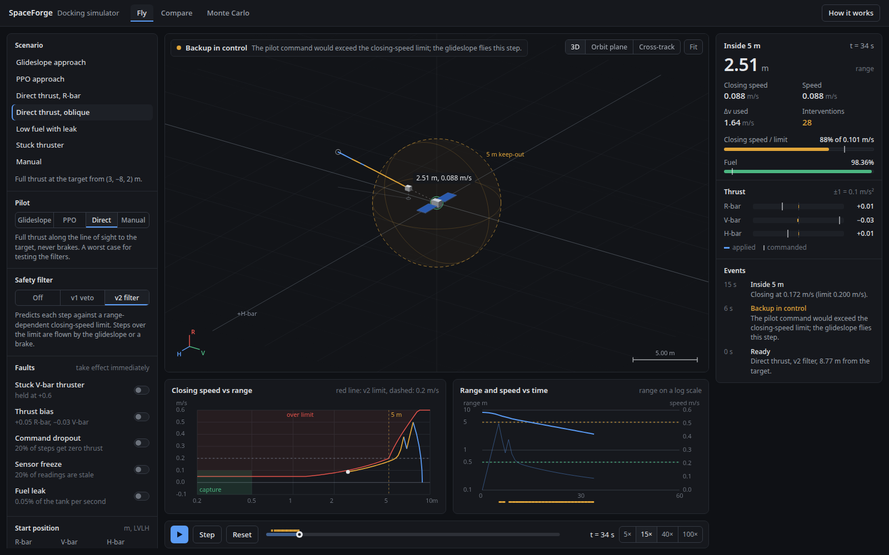

# SpaceForge

A small testbed for spacecraft rendezvous and docking in Python. A chaser vehicle starts up to 20 m
from a target and has to arrive within 0.5 m at under 0.1 m/s. Any controller can fly it: a
glideslope guidance law, a PPO policy, a "direct" law that thrusts straight at the target and never
brakes, or you with a keyboard. A
runtime-assurance filter sits between the controller and the thrusters and takes over for any step
that would leave a closing-speed envelope.

Relative motion uses the Clohessy-Wiltshire equations, propagated with their exact state transition
matrix. Everything runs on a CPU.



## Quick start

Open [`spaceforge_mvp/viz/dashboard.html`](spaceforge_mvp/viz/dashboard.html) in a browser. It is
a single file with no server and no dependencies. It runs the simulator, both safety filters and the
trained PPO network in the page:

- **Fly**: pick a controller and a safety filter, start, and toggle faults while it flies. Keys
  `W/S`, `A/D`, `Q/E` steer when you are the pilot.
- **Compare**: one start flown with no filter, the v1 veto and the v2 filter side by side.
- **Monte Carlo**: many random starts per filter; click a point to fly that start.

The page runs a JavaScript port of the Python simulator. `node spaceforge_mvp/viz/lab/sim.test.js`
checks it against fixtures generated from Python (1063 checks, including 12 full episodes matched
step by step), and CI runs that check.

To run the Python side:

```bash
python3 -m venv .venv && source .venv/bin/activate
pip install torch --index-url https://download.pytorch.org/whl/cpu
pip install -r requirements.txt && pip install -e .
pytest -q                                   # 91 tests

python3 -m spaceforge_mvp.simulate --controller glideslope --safety v2 \
  --start-pos 12 -7 3.5 --target-pos 0 0 0 --start-vel 0 0 0 --target-vel 0 0 0 \
  --fuel 1.0 --duration 300 --dt 1 --mean-motion 0.00113 --seed 42 --output-dir runs/demo
```

[docs/usage.md](docs/usage.md) covers every command, the videos and troubleshooting.

## Results

500 random starts within 20 m, default settings (0.1 m/s² per unit command, 1 s step):

| Controller | Filter | Docked | Collisions | Fastest entry into the 5 m keep-out zone |
|---|---|---|---|---|
| Glideslope | any | 500/500 | 0 | 0.175 m/s |
| PPO (shipped checkpoint) | off or v1 | 500/500 | 0 | 0.958 m/s |
| PPO (shipped checkpoint) | v2 | 500/500 | 0 | 0.194 m/s, 10.8 takeovers per flight |

The PPO policy docks every time, but on its own it enters the keep-out zone at almost five times
the 0.2 m/s limit. With v2 in the loop it stays under the limit.

The direct law, 250 starts within 6 m (Monte Carlo tab of the
browser simulator):

| Filter | Docked | Collisions |
|---|---|---|
| off | 0 | 247 |
| v1 (veto) | 0 | 137 |
| v2 | 250 | 0 |

The PPO policy is slower than the glideslope (206 vs 107 steps) and uses more fuel (0.024 vs 0.014
of the tank). Its training is unstable: held-out success across snapshots of one run went 100, 58,
31, 1, 86, 98%. Full numbers and how to reproduce them: [docs/results.md](docs/results.md).

## How the safety filter works

- **v1** rejects any command inside 5 m that does not lower the speed while the vehicle is moving
  faster than 0.2 m/s. A rejected command is zeroed, so the vehicle coasts. Coasting is not
  braking, which is why v1 still lets the direct law hit the target.
- **v2** predicts each step under the controller's command and checks it against a closing-speed
  limit. Outside 5 m the limit is a braking curve that ends at 0.2 m/s at the keep-out boundary.
  Inside 5 m it tapers to 0.05 m/s. If the step would break the limit, the glideslope flies that
  step instead; if the glideslope would also break it, a brake sized to the excess speed does.
  This is the Simplex pattern: an unverified controller flies until a simple, well-understood one
  has to take over.

[docs/design.md](docs/design.md) has the dynamics, environment, reward and filter in detail.

## Repository layout

```
spaceforge_mvp/
  core/cw_dynamics.py       exact CW propagation
  env/spacecraft_env.py     Gymnasium environment (10-D observation, 3-D thrust command)
  safety/mission_safety.py  v1 interlock and the shared speed envelope
  control/glideslope.py     glideslope guidance and the direct test law
  control/rta.py            v2 runtime-assurance filter
  training/, eval/          PPO training, evaluation, validation matrix
  simulate.py               command-line mission runner
  viz/lab/                  browser simulator sources; dashboard.py bundles them
  viz/render.py             MP4 renderer
checkpoints/                shipped PPO policy and how it was selected
ros2_ws/                    ROS 2 Humble / Gazebo Harmonic packages
docs/                       design, results, usage, project report
```

## ROS 2 and Gazebo

`ros2_ws/` holds eight packages:

| Package | Contents |
|---|---|
| `spaceforge_gazebo` | Gazebo plugin propagating the same CW dynamics, and the ROS bridge |
| `spaceforge_rl_env` | the environment over ROS transport |
| `spaceforge_rl_trainer` | PPO training against it |
| `spaceforge_mission_ctrl` | goal validation and thrust limits, independent of whoever proposes goals |
| `spaceforge_llm_planner` | an LLM that may only propose goals to `mission_ctrl` |
| `spaceforge_perception` | target pose from keypoints with solvePnP |
| `spaceforge_auto_trainer` | Optuna search and a training curriculum |
| `spaceforge_observability` | telemetry bridge, replay and a browser console |

They build, and their 170 tests pass in a Humble + Harmonic container that matches the `ros` CI job,
including one test that drives the chaser in a live headless Gazebo. A full docking run inside
Gazebo has not been done.

## Known gaps

- The ROS mission controller does not yet enforce the outer braking curve that v2 uses.
- The PPO policy was trained and tested only without randomization or faults.
- The browser simulator matches Python exactly only for noise-free runs; random draws use a
  different generator.

## License

MIT. See [LICENSE](LICENSE).
