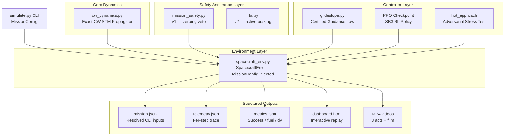
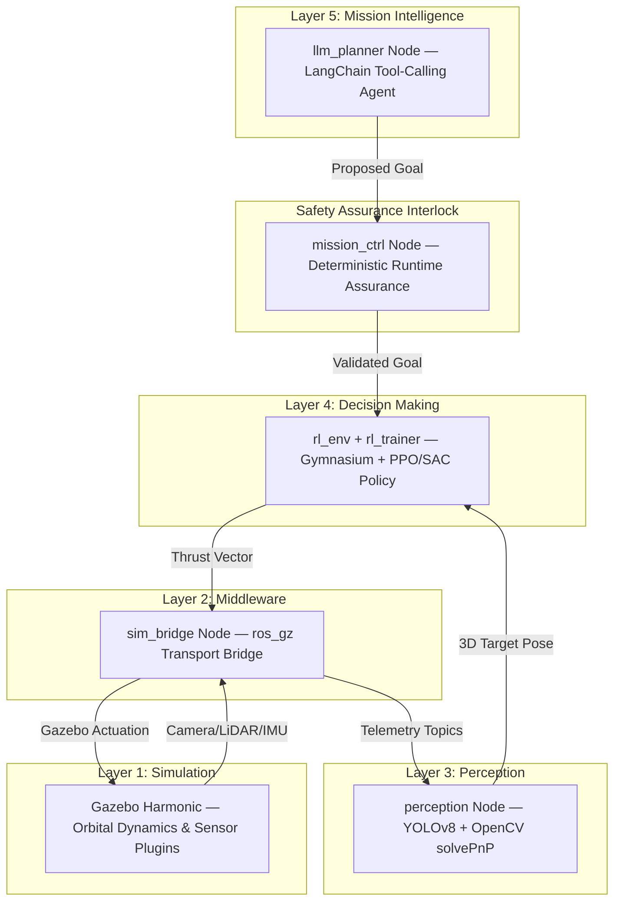

# SpaceForge — Autonomous Spacecraft Rendezvous & Docking Framework

[](https://www.python.org/)
[](https://opensource.org/licenses/MIT)
[]()

> **Status** — `MVP_SUMMARY.md` is the source of truth for what works and what does not.
> The shipped PPO checkpoint scores **0 successes in 50 episodes**. The certified Glideslope
> baseline docks **200/200 seeds**. `ros2_ws/` holds an optional Phase-1 ROS 2 / Gazebo /
> YOLOv8 / LangChain integration (7 packages, contract-first) that needs ROS 2 Humble +
> Gazebo Harmonic to validate — it does not replace the pure-Python MVP below.

**SpaceForge** is a simulation-first testbed for autonomous spacecraft rendezvous, proximity operations,
and docking (RPO/Docking). It combines orbital relative dynamics, continuous reinforcement learning (PPO),
deterministic runtime-assurance safety interlocks, a certified classical guidance baseline, and a
fully CLI-driven mission orchestration layer into one unified pure-Python stack.

---

## Table of Contents
1. [What This Repository Contains](#1-what-this-repository-contains)
2. [Architecture & Component Breakdown](#2-architecture--component-breakdown)
3. [CLI Simulation — Quick Reference](#3-cli-simulation--quick-reference)
4. [Local Setup](#4-local-setup)
5. [Command Reference](#5-command-reference)
6. [Output Files](#6-output-files)
7. [Full Production Architecture (Blueprint)](#7-full-production-architecture-blueprint)
8. [Future Roadmap](#8-future-roadmap)

---

## 1. What This Repository Contains

```
spaceforgemvp/
├── pyproject.toml                 ← PEP 517 build config (pip install -e .)
├── requirements.txt               ← Pinned dependencies
├── checkpoints/
│   └── ppo_spacecraft_final.zip  ← Pre-trained PPO checkpoint (0% success — known issue)
└── spaceforge_mvp/
    ├── config.py                  ← PhysicsConfig, SafetyConfig, EnvConfig, MissionConfig
    ├── simulate.py                ← CLI mission orchestrator (main entry point)
    ├── core/
    │   └── cw_dynamics.py         ← Exact CW State Transition Matrix propagator
    ├── env/
    │   └── spacecraft_env.py      ← Gymnasium env — accepts injected MissionConfig
    ├── safety/
    │   └── mission_safety.py      ← Safety interlock v1 (zeroing veto)
    ├── control/
    │   ├── glideslope.py          ← Certified guidance law (200/200 dockings)
    │   └── rta.py                 ← Runtime Assurance v2 (active braking override)
    ├── training/
    │   └── train.py               ← SB3 PPO training pipeline
    ├── eval/
    │   ├── run_eval.py            ← Multi-episode tabular evaluator
    │   └── plot_trajectory.py     ← 2D trajectory plotter
    ├── viz/
    │   ├── record.py              ← Episode telemetry recorder (JSON traces)
    │   ├── scenarios.py           ← 5 benchmark scenario builder
    │   ├── render.py              ← 1920×1080 MP4 renderer
    │   ├── make_videos.py         ← Video compilation (3 acts + film)
    │   ├── dashboard.py           ← Standalone interactive HTML dashboard
    │   └── dashboard.html         ← Generated artifact (open in any browser)
    └── tests/                     ← 40 automated tests (all passing)
        ├── test_cw_dynamics.py
        ├── test_spacecraft_env.py
        ├── test_mission_safety.py
        ├── test_env_safety_integration.py
        ├── test_rta.py
        ├── test_mission_cli.py    ← NEW: CLI parsing, relative state, output files
        ├── test_train_smoke.py
        ├── test_eval_smoke.py
        └── test_integration_smoke.py
```

### Quick Folder & Directory Map

| Folder / File | What it contains | Simple Description |
|---|---|---|
| 📁 `core/` | [`cw_dynamics.py`](file:///home/vivek/Desktop/SpaceForge/spaceforgemvp/spaceforge_mvp/core/cw_dynamics.py) | **Physics Engine:** Math for orbital motion (Clohessy-Wiltshire relative dynamics & state matrix). |
| 📁 `env/` | [`spacecraft_env.py`](file:///home/vivek/Desktop/SpaceForge/spaceforgemvp/spaceforge_mvp/env/spacecraft_env.py) | **Gym Environment:** 10D sensor inputs, 3D thrusters, docking reward calculations. |
| 📁 `safety/` | [`mission_safety.py`](file:///home/vivek/Desktop/SpaceForge/spaceforgemvp/spaceforge_mvp/safety/mission_safety.py) | **Safety Interlock (v1):** Basic safety rules (fuel floor check & proximity speed veto). |
| 📁 `control/` | [`glideslope.py`](file:///home/vivek/Desktop/SpaceForge/spaceforgemvp/spaceforge_mvp/control/glideslope.py), [`rta.py`](file:///home/vivek/Desktop/SpaceForge/spaceforgemvp/spaceforge_mvp/control/rta.py) | **Controllers & Filters:** Certified Glideslope guidance law + v2 active-braking safety filter. |
| 📁 `training/` | [`train.py`](file:///home/vivek/Desktop/SpaceForge/spaceforgemvp/spaceforge_mvp/training/train.py) | **AI Training:** Script to train PPO reinforcement learning models with Stable-Baselines3. |
| 📁 `eval/` | [`run_eval.py`](file:///home/vivek/Desktop/SpaceForge/spaceforgemvp/spaceforge_mvp/eval/run_eval.py), [`plot_trajectory.py`](file:///home/vivek/Desktop/SpaceForge/spaceforgemvp/spaceforge_mvp/eval/plot_trajectory.py) | **Evaluation & 2D Plots:** Multi-episode metrics benchmark and trajectory PNG image generator. |
| 📁 `viz/` | `record.py`, `dashboard.py`, `render.py`, `make_videos.py` | **Visuals & Telemetry:** Generates interactive HTML dashboard and broadcast MP4 videos. |
| 📁 `tests/` | 12 test files | **Test Suite:** 40 automated unit & integration tests verifying math, env, and CLI. |
| 📁 `checkpoints/` | `ppo_spacecraft_final.zip` | **Model Weights:** Saved PPO reinforcement learning policy checkpoints. |
| 📁 `runs/` | `mission.json`, `telemetry.json`, `metrics.json` | **Output Results:** Saved telemetry logs and metrics from simulation runs. |
| 📄 `simulate.py` | CLI Entrypoint | **Main Simulator:** Single command to run missions with custom positions, fuel, and controllers. |
| 📄 `config.py` | Config Classes | **Constants & Configs:** Physical constants, reward weights, and `MissionConfig` data structures. |

---

## 2. Architecture & Component Breakdown



### Module Details

| Module | Lines | What it does |
|---|---|---|
| `config.py` | 82 | `MissionConfig` dataclass: positions, velocities, fuel, dt, safety mode. Derives `relative_pos` / `relative_vel`. |
| `simulate.py` | 120 | CLI entry point. All mission values are required flags. Writes `mission.json`, `telemetry.json`, `metrics.json`. |
| `core/cw_dynamics.py` | 136 | Exact 6×6 CW STM: `X(k+1) = Φ(dt)·X(k) + Γ(dt)·u`. No numerical integrator. |
| `env/spacecraft_env.py` | 247 | 10-D obs, 3-D continuous action, safety interlock wired in. Accepts injected `MissionConfig` — no hardcoded positions. |
| `safety/mission_safety.py` | 90 | Interlock v1: fuel floor → emergency hold; inside 5 m at speed > 0.2 m/s → zero thrust. |
| `control/glideslope.py` | 87 | Exponential range decay + CW feed-forward cancellation. 200/200 dockings, 0 interlock fires. |
| `control/rta.py` | 97 | Interlock v2: replaces veto with maximum braking (`u · v ≤ 0`). Turns reckless slam → soft dock in 8 s. |
| `viz/record.py` | 220 | Rolls out episode via `SpacecraftEnv`, returns JSON trace (pos, vel, cmd, applied, fuel, overrides). |
| `viz/dashboard.py` | 497 | Self-contained HTML replay: play/pause, frame step, speed control, log-scale range chart. |
| `viz/render.py` | 638 | Broadcast-grade MP4: HUD, thrust decomposition, range strip, title/result cards. |
| `training/train.py` | 206 | SB3 PPO pipeline. Accepts optional `MissionConfig` for fixed-state training runs. |
| `eval/validation_matrix.py` | — | Phase 6 matrix: 120+ episodes × domain levels, pose/LLM/curriculum/sim2sim probes, JSON report. |
| `config.py: DomainConfig/FaultConfig` | — | Mass/inertia, thrust & camera/IMU noise, fuel spread, stuck/bias/dropout/freeze/leak faults. Identity by default. |

---

## 3. CLI Simulation — Quick Reference

Every mission value is supplied on the command line. Nothing is hardcoded.

```
CLI positions/velocities → Hill-frame (x=radial, y=in-track, z=cross-track)
relative_pos = start_pos − target_pos   (computed automatically)
Target is NOT required to be at origin.
```

**Controller choices:**

| `--controller` | What runs |
|---|---|
| `glideslope` | Certified deterministic guidance — always works |
| `rl` | Loaded PPO checkpoint — requires `--checkpoint` |
| `hot` | Reckless full-thrust slam — safety stress test |

**Safety mode choices:**

| `--safety` | Behaviour when inside 5 m at speed > 0.2 m/s |
|---|---|
| `off` | No interlock — counterfactual baseline |
| `v1` | Zero thrust (chaser coasts — still a collision) |
| `v2` | Substitute maximum braking — prevents collision |

---

## 4. Local Setup

```bash
git clone https://github.com/jwrhw7tueydwtt7575g/SpaceTry.git
cd SpaceTry

python3 -m venv .venv
source .venv/bin/activate
pip install -r requirements.txt
pip install -e .
```

Verify installation:

```bash
python3 -m pytest spaceforge_mvp/tests -q        # 64 passed
```

---

## 5. Command Reference

### Run a Mission Simulation

```bash
python3 -m spaceforge_mvp.simulate \
  --controller glideslope \
  --start-pos 12 -7 3.5 \
  --target-pos 2 1 0 \
  --start-vel 0 0 0 \
  --target-vel 0 0 0 \
  --fuel 0.8 \
  --duration 120 \
  --dt 1 \
  --mean-motion 0.00113 \
  --safety v2 \
  --seed 42 \
  --output-dir runs/my_mission
```

Prints metrics summary to console. Writes `mission.json`, `telemetry.json`, `metrics.json` to `runs/my_mission/`.

### Run RL Checkpoint

```bash
python3 -m spaceforge_mvp.simulate \
  --controller rl \
  --checkpoint checkpoints/ppo_spacecraft_final.zip \
  --start-pos 12 -7 3.5 --target-pos 0 0 0 \
  --start-vel 0 0 0 --target-vel 0 0 0 \
  --fuel 1.0 --duration 300 --dt 1 --mean-motion 0.00113 \
  --safety v1 --seed 42 \
  --output-dir runs/rl_run
```

### Train a New PPO Policy

```bash
# Smoke test (500 steps)
python3 -m spaceforge_mvp.training.train --total_timesteps 500

# Full training (200,000 steps)
python3 -m spaceforge_mvp.training.train --total_timesteps 200000 --seed 42
```

Training is always separate from simulation. `simulate` requires an existing checkpoint.

### Evaluate a Checkpoint (multi-episode table)

```bash
python3 -m spaceforge_mvp.eval.run_eval \
  --checkpoint checkpoints/ppo_spacecraft_final.zip \
  --episodes 50
```

### Generate the Interactive Dashboard

```bash
python3 -m spaceforge_mvp.viz.scenarios   # records 5 benchmark traces
python3 -m spaceforge_mvp.viz.dashboard   # builds dashboard.html
xdg-open spaceforge_mvp/viz/dashboard.html
```

### Render MP4 Videos (requires ffmpeg)

```bash
python3 -m spaceforge_mvp.viz.make_videos --film
# Writes: 01_docking.mp4, 02_rl_policy.mp4, 03_runtime_assurance.mp4, 00_presentation.mp4
```

---

## 6. Output Files

Every `simulate` run writes three files to `--output-dir`:

| File | Contents |
|---|---|
| `mission.json` | Resolved CLI inputs: start/target positions, relative state, fuel, dt, safety mode, seed |
| `telemetry.json` | Per-step frames: `t`, `pos`, `vel`, `cmd`, `applied`, `override`, `dist`, `speed`, `fuel`, `dv` |
| `metrics.json` | Summary: `success`, `steps`, `start_dist`, `end_dist`, `end_speed`, `fuel_used`, `dv`, `overrides` |

---

## 7. Full Production Architecture (Blueprint)

The production system is a 5-layer robotics stack. The Phase-1 ROS 2 packages already
exist under `ros2_ws/src/` (gazebo, rl_env, rl_trainer, mission_ctrl, perception,
llm_planner, auto_trainer) but require ROS 2 Humble + Gazebo Harmonic to run; the
pure-Python MVP below remains the validated reference oracle.



---

## 8. Future Roadmap

| Phase | What | Status |
|---|---|---|
| **Done** | Physics engine, Gym env, CLI simulator, glideslope baseline, v2 RTA, telemetry recorder, dashboard, videos, 64 tests | ✅ |
| **Done** | CI: Python + frontend + lint workflows green; ROS/colcon/C++ workflow provided | ✅ |
| **Done** | Independent RK4 reference test for CW STM correctness | ✅ |
| **Next** | Redesign RL reward (add boundary penalty, tie effort to fuel) and retrain | ⬜ |
| **Next** | Wire v2 RTA into `spacecraft_env.py` as the default interlock | ⬜ |
| **Phase 1 (unverified here)** | Gazebo Harmonic plugin + ROS 2 middleware nodes exist in `ros2_ws` | 🟡 |
| **Phase 1 (unverified here)** | YOLOv8 + solvePnP perception layer exists in `ros2_ws` | 🟡 |
| **Phase 1 (unverified here)** | LLM mission planner exists in `ros2_ws` (+ offline default) | 🟡 |
| **Phase 1 (unverified here)** | Optuna HPO curriculum manager exists in `ros2_ws` | 🟡 |

---

## License & Citation

Distributed under the **MIT License**.

```bibtex
@misc{spaceforge2026,
  author    = {Chaudhari, Vivek},
  title     = {SpaceForge: Autonomous Spacecraft Rendezvous \& Docking Testbed},
  year      = {2026},
  publisher = {GitHub},
  journal   = {GitHub Repository},
  howpublished = {\url{https://github.com/jwrhw7tueydwtt7575g/SpaceTry}}
}
```
