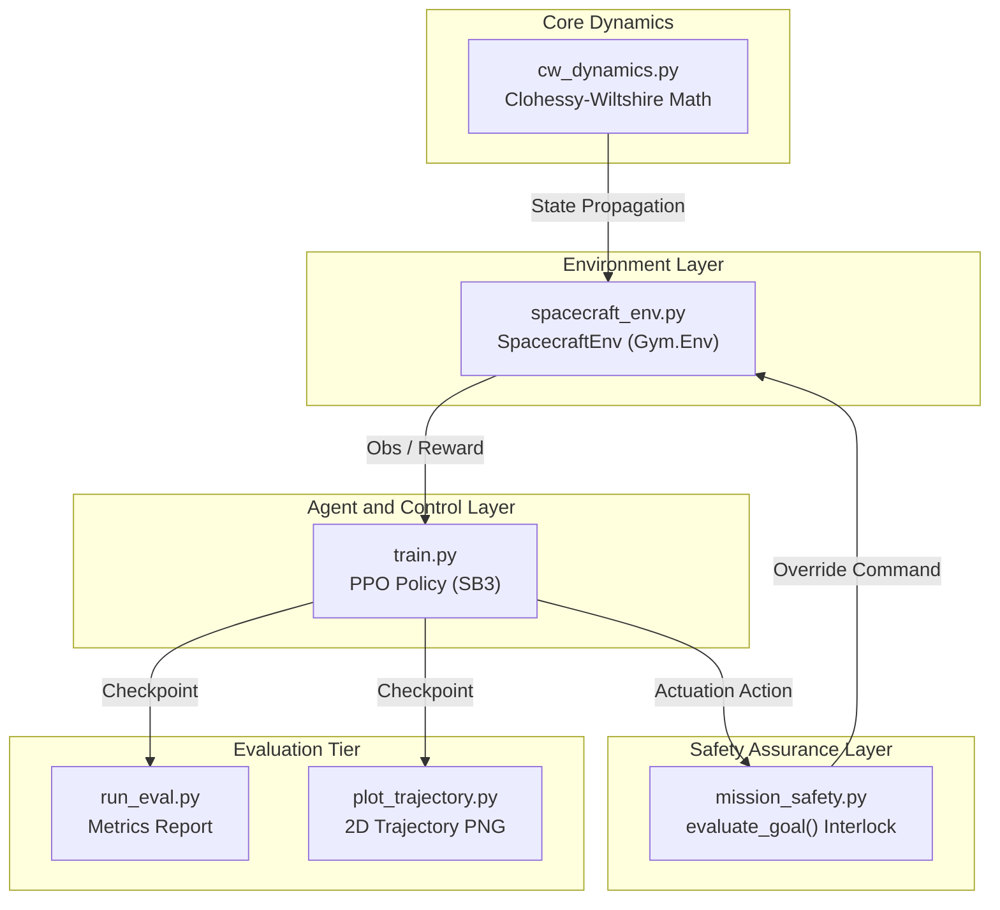
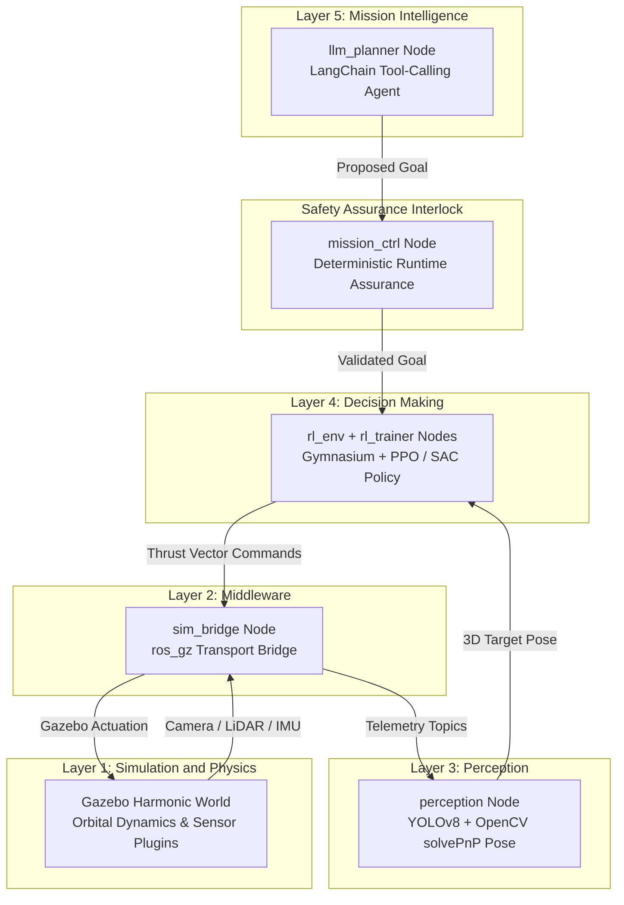
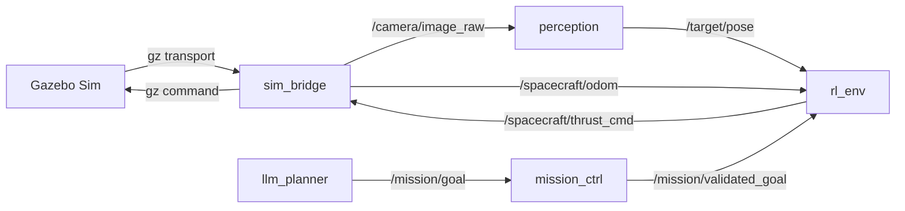

# SpaceForge — Autonomous Spacecraft Rendezvous & Docking Framework

[](https://www.python.org/)
[](https://opensource.org/licenses/MIT)
[]()

**SpaceForge** is a simulation-first testbed for autonomous spacecraft rendezvous, proximity operations, and docking (RPO/Docking). It combines orbital relative dynamics, continuous reinforcement learning (PPO), deterministic runtime assurance safety interlocks, and strategic LLM reasoning into a unified control stack.

This repository (`spaceforge-mvp`) houses the **Algorithmic & Control-Theoretic MVP** — a high-speed, pure-Python numerical prototype designed to validate dynamics, Gymnasium environment mechanics, PPO policy learning, and safety interlock logic before deploying onto full ROS 2 / Gazebo Harmonic robotics middleware.

---

## Table of Contents
1. [Overview & What Has Been Done](#1-overview--what-has-been-done)
2. [MVP Architecture & Component Breakdown](#2-mvp-architecture--component-breakdown)
3. [Full Production Architecture (Blueprint Reference)](#3-full-production-architecture-blueprint-reference)
4. [ROS 2 Node & Topic Wiring Map](#4-ros-2-node--topic-wiring-map)
5. [End-to-End Data & Control Flow](#5-end-to-end-data--control-flow)
6. [Future Build Roadmap & Integration Phases](#6-future-build-roadmap--integration-phases)
7. [Curriculum Stages & Mission Scenarios](#7-curriculum-stages--mission-scenarios)
8. [Quick-Start & Command Reference](#8-quick-start--command-reference)

---

## 1. Overview & What Has Been Done

The `spaceforge-mvp` codebase has been fully scaffolded, implemented, and verified across all core modules with **20 automated unit and integration tests (100% passing)**.

### Completed MVP Deliverables

```
spaceforge-mvp/
├── pyproject.toml                  <- Standard PEP 517 build configuration (pip install -e .)
├── requirements.txt                <- Pinned dependencies (numpy, gymnasium, SB3, pytest, matplotlib)
├── README.md                       <- Full architecture & blueprint guide
├── LICENSE                         <- MIT License file
├── checkpoints/                    <- Model checkpoint directory
└── spaceforge_mvp/
    ├── config.py                   <- Centralized physics, safety, env parameters
    ├── core/                       <- Clohessy-Wiltshire relative orbital dynamics
    │   └── cw_dynamics.py          <- cw_accel() + cw_step() (Exact CW STM Propagator)
    ├── env/                        <- Gymnasium environment
    │   └── spacecraft_env.py       <- SpacecraftEnv (10-D normalized obs, 3-D continuous action)
    ├── safety/                     <- Mission safety interlock layer (Runtime Assurance)
    │   └── mission_safety.py       <- evaluate_goal() directional braking safety gate
    ├── training/                   <- Reinforcement learning training script
    │   └── train.py                <- PPO training loop with CheckpointCallback & seed support
    ├── eval/                       <- Policy evaluation & visualization
    │   ├── run_eval.py             <- Multi-episode tabular evaluator
    │   └── plot_trajectory.py      <- Matplotlib 2D trajectory generator (eval/trajectory.png)
    └── tests/                      <- Full test suite (20 test cases)
        ├── conftest.py
        ├── test_cw_dynamics.py
        ├── test_spacecraft_env.py
        ├── test_mission_safety.py
        ├── test_env_safety_integration.py
        ├── test_train_smoke.py
        ├── test_eval_smoke.py
        └── test_integration_smoke.py
```

#### Detailed Module Breakdown:
- **Orbital Dynamics (`spaceforge_mvp/core/cw_dynamics.py`)**:
  - Implements Clohessy-Wiltshire (Hill's) relative motion equations in Hill's frame (radial `x`, in-track `y`, cross-track `z`):
    `ax = 2*n*vy + 3*n^2*x`, `ay = -2*n*vx`, `az = -n^2*z`
  - Integrates state via the **Exact 6x6 Clohessy-Wiltshire State Transition Matrix (STM)** analytical propagator:
    `X(t) = Phi(t) * X(0) + Gamma(t) * u`
  - Preserves orbital energy invariants and analytical exactness independent of timestep size `dt`.

- **Gymnasium Environment (`spaceforge_mvp/env/spacecraft_env.py`)**:
  - **10-D State Observation**: Normalized position (`rel_pos / 20.0`), normalized velocity (`rel_vel / 2.0`), fuel fraction (`[0, 1]`), normalized time (`time / 300`), and 2D target bearing unit vector.
  - **3-D Continuous Action Space**: Commanded acceleration `u = [ax, ay, az]` in `[-1.0, 1.0]` m/s².
  - **Potential-Based Reward Shaping**:
    `Reward = 5.0 * (dist_prev - dist_curr) - 0.5 * speed - 0.01 * sum(|u|) + (100 if dist < 0.5 and speed < 0.1 else 0)`
  - **Speed-Gated Docking & Truncation**: Reaching `terminated=True` requires `dist < 0.5m` AND `speed < 0.1m/s`. Resource exhaustion (fuel <= 0 or time >= 300) sets `truncated=True`.

- **Runtime Assurance Safety Interlock (`spaceforge_mvp/safety/mission_safety.py`)**:
  - Priority 1: `fuel < 0.05` -> `emergency_hold` (Fuel floor override).
  - Priority 2: `goal == "APPROACH"`, `dist < 5.0m`, AND `speed > 0.2m/s`:
    Permits braking/decelerating thrust vectors (`u dot v <= 0`) inside 5m to resolve braking deadlocks, rejecting only accelerating thrust.
  - Priority 3: Otherwise -> `accepted`.

- **Training, Evaluation & Visualization (`spaceforge_mvp/training`, `spaceforge_mvp/eval`)**:
  - `train.py`: SB3 PPO training with configurable timesteps, seed support, TensorBoard logging, and `CheckpointCallback`.
  - `run_eval.py`: Evaluates policy across N episodes, checking both distance and docking speed criteria.
  - `plot_trajectory.py`: Generates static 2D relative trajectory plots (`x` radial vs `y` in-track) saved to `eval/trajectory.png`.

---

## 2. MVP Architecture & Component Breakdown



---

## 3. Full Production Architecture (Blueprint Reference)

*Reference: SpaceForge End-to-End Blueprint (5-Layer Architectural Design)*

While `spaceforge-mvp` focuses on numerical physics and policy optimization, the full SpaceForge system extends into a **5-Layer Production Robotics Stack** instantiated as **7 concrete ROS 2 nodes**:



### Architectural Layer Mapping

| Conceptual Layer | Concrete ROS 2 Node(s) | Role & Responsibility |
|---|---|---|
| **Layer 5 — Cognition** | `llm_planner` | LangChain tool-calling agent generating high-level mission goals. |
| **Safety Interlock** | `mission_ctrl` | Deterministic goal arbitration layer validating safety bounds. |
| **Layer 4 — Control** | `rl_env`, `rl_trainer` | Gymnasium wrapper + PPO/SAC continuous thrust policy. |
| **Layer 3 — Perception** | `perception` | YOLOv8 2D detector + OpenCV `solvePnP` 3D target pose estimator. |
| **Layer 2 — Middleware** | `sim_bridge` | ROS 2 / Gazebo Harmonic topic and service translation. |
| **Layer 1 — Simulation** | `Gazebo Harmonic` | High-fidelity physics, sensor rendering, and C++ CW system plugins. |
| **Orchestration Tier** | `auto_trainer`, `web_bridge` | Optuna HPO, curriculum manager, and React/Three.js web dashboard. |

---

## 4. ROS 2 Node & Topic Wiring Map

When deploying to full production ROS 2, nodes communicate via standard topics:



### ROS 2 Topic & Interface Table

| Node Name | Subscribes To | Publishes To | Rate |
|---|---|---|---|
| `sim_bridge` | Gazebo transport (`/clock`, `/imu`, `/camera`) | `/spacecraft/odom`, `/camera/image_raw` | 100 Hz |
| `perception` | `/camera/image_raw` | `/target/pose`, `/debris/detections` | 30 Hz |
| `rl_env` | `/spacecraft/odom`, `/target/pose`, `/mission/validated_goal` | `/spacecraft/thrust_cmd` | 10 Hz |
| `mission_ctrl` | `/mission/goal` | `/mission/validated_goal` | Event-driven |
| `llm_planner` | `/spacecraft/state` | `/mission/goal` | Low freq |
| `web_bridge` | `/spacecraft/odom`, `/mission/status` | WebSocket to React Frontend | 1 Hz |

---

## 5. End-to-End Data & Control Flow

The operational loop operates across strategic reasoning, tactical control, and physics execution:

```
[Camera & LiDAR Sensors] ──> Gazebo Physics ──> sim_bridge
                                                   │
                                            /camera/image_raw
                                                   │
                                                   ▼
                                         perception (YOLOv8 + solvePnP)
                                                   │
                                            /target/pose (3D Position/Attitude)
                                                   │
   LangChain LLM Agent ──> /mission/goal ──> mission_ctrl (Safety Interlock)
                                                   │
                                        /mission/validated_goal
                                                   │
                                                   ▼
                                       rl_env (SpacecraftEnv)
                                                   │
                                      PPO Neural Policy Evaluation
                                                   │
                                        /spacecraft/thrust_cmd
                                                   │
                                                   ▼
                                    sim_bridge ──> Gazebo Thrusters
```

---

## 6. Future Build Roadmap & Integration Phases

*Extracted from Section 7 & 8 of the SpaceForge End-to-End Blueprint.*

The full build sequence follows a strict **bottom-up engineering order**:

```
Phase 1: Foundation ──> Phase 2: Control Core ──> Phase 3: Perception & Cognition ──> Phase 4: Auto-Training ──> Phase 5: Observability ──> Phase 6: Hardening
```

### Phase Breakdown

#### Phase 1 — Foundation
- Build Gazebo `leo_orbit.sdf` world and `chaser_sat` / `target_sat` SDF models.
- Implement C++ `orbital_dynamics.cc` Gazebo system plugin for CW motion.
- Implement `sim_bridge` node publishing `/spacecraft/odom`, `/spacecraft/imu`, `/camera/image_raw`.

#### Phase 2 — Control Core
- Port numerical `SpacecraftEnv` into a ROS 2 live-sim Gymnasium wrapper.
- Configure `rl_trainer` node running SB3 PPO/SAC with `SubprocVecEnv` across parallel Gazebo instances.
- Achieve Stage-1 curriculum 1-D approach convergence.

#### Phase 3 — Perception & Cognition
- Build `perception` node combining YOLOv8 bounding box detection with OpenCV `solvePnP` pose estimation.
- Integrate ROS 2 `mission_ctrl` safety interlock node.
- Build LangChain `llm_planner` tool-calling agent with `PlaybookManager` for dynamic prompt adaptation.

#### Phase 4 — Auto-Training & HPO
- Build `curriculum_manager` node with threshold-based 5-stage advancement.
- Integrate Optuna SQLite-backed study for automated hyperparameter tuning (learning rate, batch size, clip range).

#### Phase 5 — Observability Tier
- Build `web_bridge` WebSocket telemetry server.
- Construct React + Three.js web dashboard rendering live 3D orbital trajectories, TensorBoard graphs, and LLM reasoning traces.

#### Phase 6 — Hardening & Sim-to-Real
- Domain randomization: spacecraft mass/inertia (+/- 20%), thruster noise (+/- 10%).
- Sensor noise injection (IMU Gaussian noise, camera lens distortion).
- Communication latency simulation (1ms to 10ms).
- Hardware-In-The-Loop (HIL) prep and open-source release.

---

## 7. Curriculum Stages & Mission Scenarios

To ensure policy stability, training follows a 5-stage curriculum managed by `curriculum_manager`:

| Stage | Scenario Name | Starting Distance | Max Relative Velocity | Success Threshold |
|---|---|---|---|---|
| **Stage 1** | 1-D Radial Approach | 5.0 m (1-D) | 0.05 m/s | 90% Success Rate |
| **Stage 2** | 3-D Point Rendezvous | 20.0 m (3-D) | 0.10 m/s | 85% Success Rate |
| **Stage 3** | Tumbling Target Docking | 10.0 m (Spinning target) | 0.20 m/s | 75% Success Rate |
| **Stage 4** | Debris Field Avoidance | 30.0 m (Obstacles present) | 0.25 m/s | 70% Success Rate |
| **Stage 5** | Multi-Surface Inspection | 50.0 m (Complex trajectory) | 0.30 m/s | 65% Success Rate |

---

## 8. Quick-Start & Command Reference

### 1. Environment Setup & Editable Package Installation
```bash
git clone https://github.com/jwrhw7tueydwtt7575g/SpaceTry.git
cd SpaceTry

# Install package in editable mode
pip install -e .
```

### 2. Run Full Test Gate (20 Unique Tests)
```bash
pytest -v
```

### 3. Run PPO Policy Training
```bash
# Full 200,000-timestep training run
python3 -m spaceforge_mvp.training.train --total_timesteps 200000 --seed 42

# Fast 500-step smoke training run
python3 -m spaceforge_mvp.training.train --total_timesteps 500 --save_dir checkpoints
```

### 4. Evaluate Policy Checkpoint
```bash
# Evaluate final checkpoint over 50 episodes
python3 -m spaceforge_mvp.eval.run_eval --checkpoint checkpoints/ppo_spacecraft_final.zip --episodes 50
```

### 5. Generate Trajectory Visualization
```bash
# Generate 2D plot saved to eval/trajectory.png
python3 -m spaceforge_mvp.eval.plot_trajectory --checkpoint checkpoints/ppo_spacecraft_final.zip --output eval/trajectory.png
```

---

## License & Citation

Distributed under the **MIT License**.

```bibtex
@misc{spaceforge2026,
  author = {Chaudhari, Vivek},
  title = {SpaceForge: Autonomous Spacecraft Rendezvous & Docking Testbed},
  year = {2026},
  publisher = {GitHub},
  journal = {GitHub Repository},
  howpublished = {\url{https://github.com/jwrhw7tueydwtt7575g/SpaceTry}}
}
```
