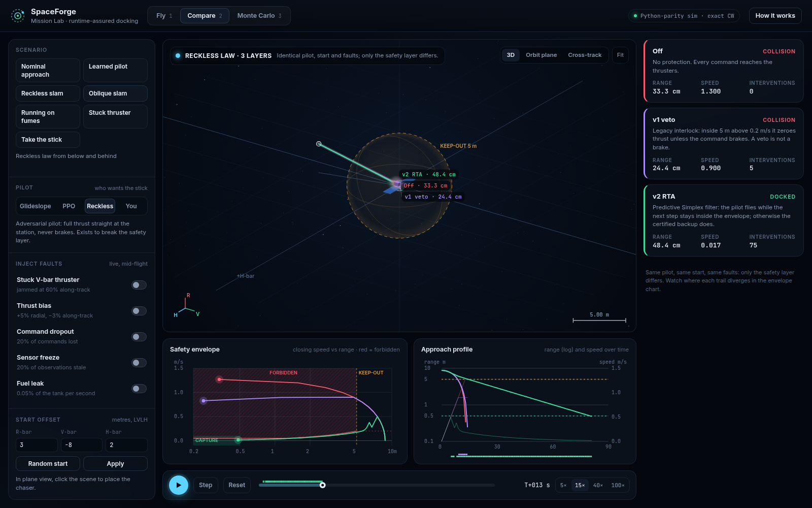
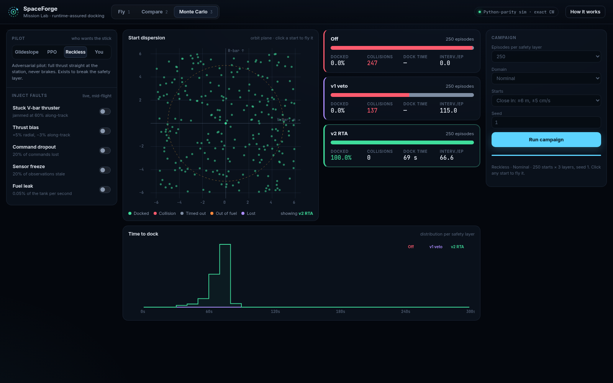
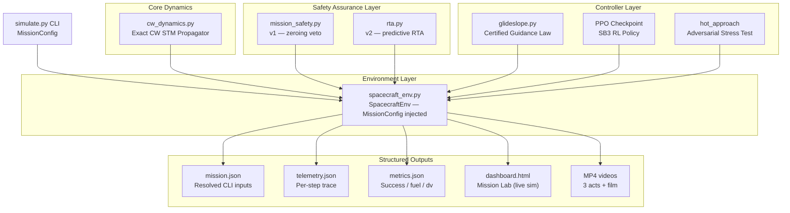
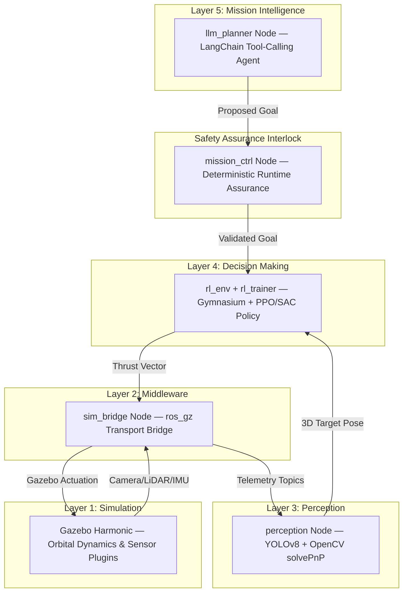

# SpaceForge — Runtime-Assured Spacecraft Docking

[](https://www.python.org/)
[](https://opensource.org/licenses/MIT)
[]()

**Let anything fly the spacecraft. Never let it hit the station.**

SpaceForge is a testbed for autonomous rendezvous and docking built around one idea: every pilot
(a learned PPO policy, an LLM-planned goal, a human on a joystick) is *untrusted*. A
runtime-assurance (RTA) filter predicts each control step against a closing-speed envelope and only
when the step would breach it hands that step to a certified backup law (the Simplex architecture).
The pilot keeps the stick the rest of the time.


## Try it: the Mission Lab

Open [`spaceforge_mvp/viz/dashboard.html`](spaceforge_mvp/viz/dashboard.html) in a browser. It is
one self-contained file, with no server and no install. The exact Clohessy-Wiltshire simulator, both safety
layers and the shipped PPO network all run live in the page:

- **Fly**: pick a pilot (certified glideslope, the PPO policy, a reckless full-thrust law, or
  *you* on W/A/S/D/Q/E), pick a safety layer, and inject faults mid-flight (stuck thruster, bias,
  command dropout, sensor freeze, fuel leak). The scene shows who has authority on every step, the
  "if the thrusters died now" coast arc, and the trajectory in the safety-envelope phase plane.
- **Compare**: the same pilot, start and faults under *off*, *v1 veto* and *v2 RTA* at once.
- **Monte Carlo**: hundreds of randomized starts per safety layer, with domain randomization or
  faults; click any start to fly it.

| Compare: one pilot, three safety layers | Monte Carlo: reckless pilot, 250 close-in starts |
|---|---|
|  |  |

The browser simulation is a port, so it is only as good as its parity tests:
[`lab/sim.test.js`](spaceforge_mvp/viz/lab/sim.test.js) replays 1063 checks generated by the Python
reference ([`lab_export.py`](spaceforge_mvp/viz/lab_export.py)): unit cases for the dynamics, both
filters, the glideslope and the brakes, plus 12 full episodes step by step (to 1e-9 m) including
PPO. [`test_lab_export.py`](spaceforge_mvp/tests/test_lab_export.py) fails if those fixtures drift
from the Python code or the checkpoint.

## What the numbers say

| Pilot (500 fresh seeds, ±20 m starts) | Safety layer | Docked | Collisions | Fastest keep-out entry |
|---|---|---|---|---|
| Certified glideslope | any | 500/500 | 0 | 0.175 m/s |
| Shipped PPO checkpoint | off / v1 | 500/500 | 0 | **0.958 m/s** (gate is 0.2) |
| Shipped PPO checkpoint | v2 RTA | 500/500 | 0 | 0.194 m/s (10.8 takeovers/episode) |
| Reckless full-thrust law (250 starts within ±6 m) | off / v1 / v2 | 0% / 0% / **100%** | 247 / 137 / **0** | — |

The PPO policy docks every time, but on its own it enters the 5 m keep-out sphere at almost five
times the gate speed. That is exactly the case the RTA exists for. v2's envelope is a braking curve
outside the sphere and a taper to capture speed inside it, so the vehicle reaches the sphere edge
at or below 0.2 m/s whoever is flying.

> **Status**: `MVP_SUMMARY.md` is the source of truth for what works and what does not. The PPO
> policy is slower and less fuel-efficient than the glideslope, and its training is unstable
> across snapshots. `ros2_ws/` holds the ROS 2 / Gazebo / perception / LLM integration
> (7 Python packages + a C++ Gazebo plugin); it builds and its 170 tests pass in a ROS 2 Humble +
> Gazebo Harmonic environment matching the `ros` CI job. Closed-loop docking inside Gazebo is not
> yet tested.

---

## Table of Contents
1. [What This Repository Contains](#1-what-this-repository-contains)
2. [Architecture & Component Breakdown](#2-architecture--component-breakdown)
3. [CLI Simulation — Quick Reference](#3-cli-simulation--quick-reference)
4. [Local Setup](#4-local-setup)
5. [Command Reference](#5-command-reference)
6. [Output Files](#6-output-files)
7. [Full Production Architecture (Blueprint)](#7-full-production-architecture-blueprint)
8. [Future Roadmap](#8-future-roadmap)

---

## 1. What This Repository Contains

```
spaceforgemvp/
├── pyproject.toml                 ← PEP 517 build config (pip install -e .)
├── requirements.txt               ← Pinned dependencies
├── checkpoints/
│   ├── ppo_spacecraft_final.zip  ← Pre-trained PPO checkpoint (docks; see metadata)
│   └── ppo_spacecraft_final.metadata.json ← Provenance, selection rule, measured results
└── spaceforge_mvp/
    ├── config.py                  ← PhysicsConfig, SafetyConfig, EnvConfig, MissionConfig
    ├── simulate.py                ← CLI mission orchestrator (main entry point)
    ├── core/
    │   └── cw_dynamics.py         ← Exact CW State Transition Matrix propagator
    ├── env/
    │   └── spacecraft_env.py      ← Gymnasium env — accepts injected MissionConfig
    ├── safety/
    │   └── mission_safety.py      ← Safety interlock v1 (zeroing veto)
    ├── control/
    │   ├── glideslope.py          ← Certified guidance law (200/200 dockings)
    │   └── rta.py                 ← Runtime Assurance v2 (predictive filter + certified backup)
    ├── training/
    │   └── train.py               ← SB3 PPO training pipeline
    ├── eval/
    │   ├── run_eval.py            ← Multi-episode tabular evaluator
    │   └── plot_trajectory.py     ← 2D trajectory plotter
    ├── viz/
    │   ├── record.py              ← Episode telemetry recorder (JSON traces)
    │   ├── scenarios.py           ← 5 benchmark scenario builder
    │   ├── render.py              ← 1920×1080 MP4 renderer
    │   ├── make_videos.py         ← Video compilation (3 acts + film)
    │   ├── lab/                   ← Mission Lab sources: sim.js (parity-tested port), app.js, styles.css
    │   ├── lab_export.py          ← Exports PPO weights + Python parity fixtures for the Lab
    │   ├── dashboard.py           ← Bundles lab/ into one offline HTML file
    │   └── dashboard.html         ← The Mission Lab (open in any browser)
    └── tests/                     ← 90 automated tests (all passing)
        ├── test_cw_dynamics.py
        ├── test_spacecraft_env.py
        ├── test_mission_safety.py
        ├── test_env_safety_integration.py
        ├── test_rta.py
        ├── test_mission_cli.py    ← NEW: CLI parsing, relative state, output files
        ├── test_train_smoke.py
        ├── test_eval_smoke.py
        └── test_integration_smoke.py
```

### Quick Folder & Directory Map

| Folder / File | What it contains | Simple Description |
|---|---|---|
| 📁 `core/` | [`cw_dynamics.py`](spaceforge_mvp/core/cw_dynamics.py) | **Physics Engine:** Math for orbital motion (Clohessy-Wiltshire relative dynamics & state matrix). |
| 📁 `env/` | [`spacecraft_env.py`](spaceforge_mvp/env/spacecraft_env.py) | **Gym Environment:** 10D sensor inputs, 3D thrusters, docking reward calculations. |
| 📁 `safety/` | [`mission_safety.py`](spaceforge_mvp/safety/mission_safety.py) | **Safety Interlock (v1):** Basic safety rules (fuel floor check & proximity speed veto). |
| 📁 `control/` | [`glideslope.py`](spaceforge_mvp/control/glideslope.py), [`rta.py`](spaceforge_mvp/control/rta.py) | **Controllers & Filters:** Certified Glideslope guidance law + v2 predictive runtime-assurance filter. |
| 📁 `training/` | [`train.py`](spaceforge_mvp/training/train.py) | **AI Training:** Script to train PPO reinforcement learning models with Stable-Baselines3. |
| 📁 `eval/` | [`run_eval.py`](spaceforge_mvp/eval/run_eval.py), [`plot_trajectory.py`](spaceforge_mvp/eval/plot_trajectory.py) | **Evaluation & 2D Plots:** Multi-episode metrics benchmark and trajectory PNG image generator. |
| 📁 `viz/` | `lab/`, `lab_export.py`, `dashboard.py`, `record.py`, `render.py`, `make_videos.py` | **Visuals & Telemetry:** The in-browser Mission Lab (live simulation, PPO, both safety layers) and broadcast MP4 videos. |
| 📁 `tests/` | 16 test files | **Test Suite:** 90 automated unit, integration and regression tests (math, env, safety, CLI, viz, shipped policy). |
| 📁 `checkpoints/` | `ppo_spacecraft_final.zip` | **Model Weights:** Saved PPO reinforcement learning policy checkpoints. |
| 📁 `runs/` | `mission.json`, `telemetry.json`, `metrics.json` | **Output Results:** Saved telemetry logs and metrics from simulation runs. |
| 📄 `simulate.py` | CLI Entrypoint | **Main Simulator:** Single command to run missions with custom positions, fuel, and controllers. |
| 📄 `config.py` | Config Classes | **Constants & Configs:** Physical constants, reward weights, and `MissionConfig` data structures. |

---

## 2. Architecture & Component Breakdown



### Module Details

| Module | Lines | What it does |
|---|---|---|
| `config.py` | 385 | Typed frozen configs: physics, actuator (0.1 m/s^2 per unit command), safety envelope, reward, reset, domain, faults, `MissionConfig`, `RunConfig` (JSON round trip). |
| `simulate.py` | 124 | CLI entry point. All mission values are required flags. Writes `mission.json`, `telemetry.json`, `metrics.json`. |
| `core/cw_dynamics.py` | 136 | Exact 6×6 CW STM: `X(k+1) = Φ(dt)·X(k) + Γ(dt)·u`. No numerical integrator; matches an independent RK4 to ~1e-11 m. |
| `env/spacecraft_env.py` | 415 | 10-D obs, 3-D continuous action, safety filter wired in, collision termination (swept capture-sphere test), fault/domain injection. |
| `safety/mission_safety.py` | 195 | Interlock v1 (geometric speed gate; only genuine braking passes) and the closing-speed envelope shared with v2. |
| `control/glideslope.py` | 116 | Exponential range decay + CW feed-forward at the mission's mean motion; dt- and authority-aware. 200/200 dockings, 0 interlock fires. |
| `control/rta.py` | 179 | Interlock v2: predictive envelope check; unsafe commands are replaced by the certified glideslope (Simplex) or a speed-sized brake. |
| `viz/record.py` | 274 | Rolls out an episode via `SpacecraftEnv`, honours every episode end, returns a JSON trace (pos, vel, cmd, applied, executed, fuel, overrides). |
| `viz/lab/` | ~2000 | Mission Lab: `sim.js` ports the environment, filters, glideslope and PPO forward pass; `app.js` renders the 3-D scene, envelope phase plane, compare and Monte Carlo views. |
| `viz/dashboard.py` | 70 | Inlines `lab/` into the single offline `dashboard.html`. |
| `viz/render.py` | 637 | Broadcast-grade MP4: HUD, thrust decomposition, range strip, title/result cards. |
| `training/train.py` | 245 | SB3 PPO pipeline. Accepts optional `MissionConfig` for fixed-state training runs. |
| `eval/validation_matrix.py` | 493 | Phase 6 matrix: 120 episodes × domain levels; pose error under pixel noise, LLM containment, curriculum, sim-to-sim vs independent RK4; JSON report. |
| `config.py: DomainConfig/FaultConfig` | — | Mass/inertia, thrust & camera/IMU noise, fuel spread, stuck/bias/dropout/freeze/leak faults. Identity by default. |

---

## 3. CLI Simulation — Quick Reference

Every mission value is supplied on the command line. Nothing is hardcoded.

```
CLI positions/velocities → Hill-frame (x=radial, y=in-track, z=cross-track)
relative_pos = start_pos − target_pos   (computed automatically)
Target is NOT required to be at origin.
```

**Controller choices:**

| `--controller` | What runs |
|---|---|
| `glideslope` | Certified deterministic guidance — always works |
| `rl` | Loaded PPO checkpoint — requires `--checkpoint` |
| `hot` | Reckless full-thrust slam — safety stress test |

**Safety mode choices:**

| `--safety` | Behaviour |
|---|---|
| `off` | No interlock — counterfactual baseline |
| `v1` | Veto only: inside 5 m above 0.2 m/s, any command that is not genuine braking is zeroed (the chaser coasts — can still collide) |
| `v2` | Predictive RTA: each step is checked against a closing-speed envelope (a braking curve down to 0.2 m/s at the 5 m keep-out edge, then a taper to 0.05 m/s); unsafe commands are replaced by the certified glideslope or an envelope brake. Still brakes below the fuel floor. |

The proximity rule applies to every `--goal` by default; a goal label cannot switch it off.
`--max-accel` sets the actuator authority (m/s^2 per unit command, default 0.1).

---

## 4. Local Setup

```bash
git clone https://github.com/jwrhw7tueydwtt7575g/SpaceTry.git
cd SpaceTry

python3 -m venv .venv
source .venv/bin/activate
pip install -r requirements.txt
pip install -e .
```

Verify installation:

```bash
python3 -m pytest spaceforge_mvp/tests -q        # 90 passed
```

---

## 5. Command Reference

### Run a Mission Simulation

```bash
python3 -m spaceforge_mvp.simulate \
  --controller glideslope \
  --start-pos 12 -7 3.5 \
  --target-pos 2 1 0 \
  --start-vel 0 0 0 \
  --target-vel 0 0 0 \
  --fuel 0.8 \
  --duration 120 \
  --dt 1 \
  --mean-motion 0.00113 \
  --safety v2 \
  --seed 42 \
  --output-dir runs/my_mission
```

Prints metrics summary to console. Writes `mission.json`, `telemetry.json`, `metrics.json` to `runs/my_mission/`.

### Run RL Checkpoint

```bash
python3 -m spaceforge_mvp.simulate \
  --controller rl \
  --checkpoint checkpoints/ppo_spacecraft_final.zip \
  --start-pos 12 -7 3.5 --target-pos 0 0 0 \
  --start-vel 0 0 0 --target-vel 0 0 0 \
  --fuel 1.0 --duration 300 --dt 1 --mean-motion 0.00113 \
  --safety v1 --seed 42 \
  --output-dir runs/rl_run
```

### Train a New PPO Policy

```bash
# Smoke test (500 steps)
python3 -m spaceforge_mvp.training.train --total_timesteps 500

# Full training (200,000 steps)
python3 -m spaceforge_mvp.training.train --total_timesteps 200000 --seed 42
```

Training is always separate from simulation. `simulate` requires an existing checkpoint.

### Evaluate a Checkpoint (multi-episode table)

```bash
python3 -m spaceforge_mvp.eval.run_eval \
  --checkpoint checkpoints/ppo_spacecraft_final.zip \
  --episodes 50
```

### Build the Mission Lab

```bash
python3 -m spaceforge_mvp.viz.scenarios   # records 5 benchmark traces
python3 -m spaceforge_mvp.viz.lab_export  # only after changing physics, safety or the checkpoint
node spaceforge_mvp/viz/lab/sim.test.js    # JS port vs Python fixtures
python3 -m spaceforge_mvp.viz.dashboard   # bundles lab/ into dashboard.html
xdg-open spaceforge_mvp/viz/dashboard.html
```

### Render MP4 Videos (requires ffmpeg)

```bash
python3 -m spaceforge_mvp.viz.make_videos --film
# Writes: 01_docking.mp4, 02_rl_policy.mp4, 03_runtime_assurance.mp4, 00_presentation.mp4
```

---

## 6. Output Files

Every `simulate` run writes three files to `--output-dir`:

| File | Contents |
|---|---|
| `mission.json` | Resolved CLI inputs: start/target positions, relative state, fuel, dt, safety mode, seed |
| `telemetry.json` | Per-step frames: `t`, `pos`, `vel`, `cmd`, `applied`, `executed` (m/s^2 actually delivered), `override`, `dist`, `speed`, `fuel`, `dv` |
| `metrics.json` | Summary: `success`, `steps`, `start_dist`, `end_dist`, `end_speed`, `fuel_used`, `dv` (m/s), `overrides`, `terminal_reason` (docked / collision / fuel / out_of_bounds / timeout) |

---

## 7. Full Production Architecture (Blueprint)

The production system is a 5-layer robotics stack. The Phase-1 ROS 2 packages already
exist under `ros2_ws/src/` (gazebo, rl_env, rl_trainer, mission_ctrl, perception,
llm_planner, auto_trainer). They require ROS 2 Humble + Gazebo Harmonic to run live; the
pure-Python MVP remains the reference oracle. Launch headless with
`ros2 launch spaceforge_gazebo leo_orbit.launch.py headless:=true`.



---

## 8. Future Roadmap

| Phase | What | Status |
|---|---|---|
| **Done** | Physics engine, Gym env, CLI simulator, glideslope baseline, predictive v2 RTA with outer braking curve, telemetry recorder, in-browser Mission Lab, videos | ✅ |
| **Done** | Independent RK4 reference for the CW STM; regression tests for every review finding | ✅ |
| **Done** | PPO that docks (realistic actuator authority, held-out checkpoint selection) | ✅ |
| **Done** | ROS 2 / Gazebo workspace builds; plugin + bridge + live integration test pass in the `ros` CI job | ✅ |
| **Next** | Stabilize RL training; beat the glideslope on time or fuel | ⬜ |
| **Next** | Train/validate the policy under domain randomization and faults | ⬜ |
| **Next** | Closed-loop docking run inside Gazebo | ⬜ |
| **Phase 1** | YOLOv8 + solvePnP perception (pose error 3.7 cm mean at 0.5 px keypoint noise) | 🟡 |
| **Phase 1** | LLM mission planner (+ offline default) behind the deterministic mission_ctrl boundary | 🟡 |
| **Phase 1** | Optuna HPO curriculum manager | 🟡 |

---

## License & Citation

Distributed under the **MIT License**.

```bibtex
@misc{spaceforge2026,
  author    = {Chaudhari, Vivek},
  title     = {SpaceForge: Autonomous Spacecraft Rendezvous \& Docking Testbed},
  year      = {2026},
  publisher = {GitHub},
  journal   = {GitHub Repository},
  howpublished = {\url{https://github.com/jwrhw7tueydwtt7575g/SpaceTry}}
}
```
