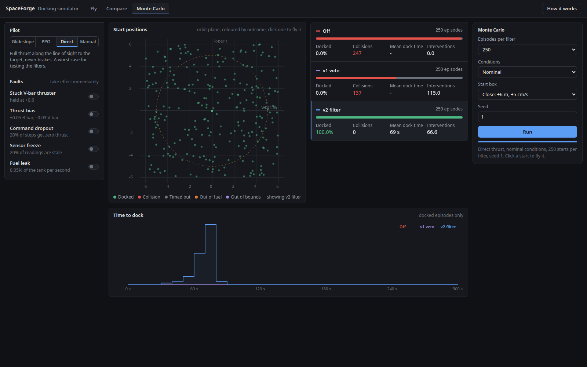

# Results

Measured with Python 3.11-3.12, numpy 1.26.4, Stable-Baselines3 2.9.0 and CPU torch, at the default
0.1 m/s² per unit command and 1 s step. Commands run from the repository root with the package
installed (`pip install -e .`).

## Recorded scenarios

`python3 -m spaceforge_mvp.viz.scenarios` writes these traces to `spaceforge_mvp/viz/scenarios/`.
For the direct-thrust runs, closest approach and speed come from replaying the commands at 10 ms, because
a 1 s step can jump over the 0.5 m capture sphere.

| Trace | Controller | Filter | Seed | Steps | Start range | Δv (m/s) | Filter actions | Outcome |
|---|---|---|---|---|---|---|---|---|
| `docking` | glideslope | v1 | 42 | 98 | 14.33 m | 1.381 | 0 | docked |
| `rl_policy` | PPO | v1 | 42 | 208 | 18.22 m | 2.148 | 0 | docked |
| `hot_open` | direct | off | 7 | 11 | 6.00 m | 1.106 | 0 | collision: 4 cm at 1.10 m/s |
| `hot_v1` | direct | v1 | 7 | 14 | 6.00 m | 0.500 | 9 | collision: 26 cm at 0.50 m/s |
| `hot_v2` | direct | v2 | 7 | 72 | 6.00 m | 0.595 | 69 | docked: 48 cm at 0.017 m/s |

## Glideslope

```bash
python3 -c "
from spaceforge_mvp.control.glideslope import glideslope_action
from spaceforge_mvp.viz.record import record_episode
runs = [record_episode(glideslope_action, seed=s, safety='v1')['summary'] for s in range(200)]
print(sum(r['success'] for r in runs), sum(r['steps'] for r in runs) / 200, sum(r['overrides'] for r in runs))"
```

200/200 docked, 107.2 steps on average, 0 filter actions. On seeds 5000-5499: 500/500 under both
v1 and v2, 0 filter actions.

## PPO policy

```bash
python3 -m spaceforge_mvp.eval.run_eval --checkpoint checkpoints/ppo_spacecraft_final.zip --episodes 50
```

| Evaluation | Result |
|---|---|
| `run_eval`, seeds 42-91 | 100% docked, fuel 0.0241, 205.8 steps, 3 filter actions in total |
| Seeds 5000-5499, filter off / v1 / v2 | 500/500 docked each, 0 collisions |
| Fastest entry into the 5 m zone, same seeds | off and v1: 0.958 m/s; v2: 0.194 m/s, 10.8 takeovers per flight, 190 steps |
| Against the glideslope | slower (206 vs 107 steps), more fuel (0.024 vs 0.014) |
| Held-out success of the snapshots of one run (50k to 300k steps) | 100, 58, 31, 1, 86, 98% |

The checkpoint was chosen on seeds 1000-1099, which are not used for any number above.

## Direct law against each filter

From the Monte Carlo tab of the browser simulator, 250 starts uniformly within ±6 m per axis:

| Filter | Docked | Collisions |
|---|---|---|
| off | 0 | 247 |
| v1 | 0 | 137 |
| v2 | 250 | 0 |



## Validation matrix

```bash
PYTHONPATH=.:ros2_ws/src/spaceforge_rl_env:ros2_ws/src/spaceforge_mission_ctrl:ros2_ws/src/spaceforge_llm_planner:ros2_ws/src/spaceforge_auto_trainer:ros2_ws/src/spaceforge_perception \
  python3 -m spaceforge_mvp.eval.validation_matrix --episodes 120 --seed 0
```

Without the ROS packages on the path, the perception, LLM and curriculum probes report
`unavailable`.

**Glideslope docking, 120 random starts per level:**

| Level | Docked | Fuel mean (max) | Δv mean | Filter actions |
|---|---|---|---|---|
| nominal | 120/120 | 0.0141 (0.0174) | 1.411 m/s | 0 |
| randomized: mass 0.8-1.2, thrust ±10%, thrust and sensor noise | 120/120 | 0.0159 (0.0237) | 1.709 m/s | 0 |
| faults: bias, 2% dropout and sensor freeze, fuel leak | 120/120 | 0.0363 (0.0456) | 1.514 m/s | 0 |

**Pose from keypoints (solvePnP), 120 random poses, targets 2-10 m away:**

| Keypoint noise | Mean error | p95 | Max |
|---|---|---|---|
| 0 px | 7.5e-08 m | 2.5e-07 m | 5.8e-07 m |
| 0.5 px | 0.037 m | 0.139 m | 0.194 m |
| 1.0 px | 0.076 m | 0.279 m | 0.382 m |

Missed or swapped keypoints are not modelled.

**LLM planner through mission_ctrl** (mock provider): 20/20 valid proposals accepted; 25/25 hostile
ones rejected. The hostile set includes actuator fields, contradictions, injection text, bad schema
versions and NaN targets.

**Curriculum:** a perfect outcome stream advances stage 1 to 2 in exactly 50 episodes; a poor one
rolls stage 2 back to 1.

**Integrator check**, 20 glideslope runs replayed with identical commands:

| Reference | Max position difference from the environment |
|---|---|
| RK4 at 10 ms | 4.5e-11 m |
| semi-implicit Euler at 0.1 s, a typical physics-engine step | 2.5 cm |

The Gazebo plugin uses the exact transition matrix, so it matches the first row, not the second.

## Browser simulator parity

`node spaceforge_mvp/viz/lab/sim.test.js`: 1063/1063 checks pass. [design.md](design.md#browser-simulator)
lists what they cover.

## Tests

| Suite | Command | Result |
|---|---|---|
| Python | `pytest -q` | 91 passed |
| ROS packages without ROS | see the `python` job in `.github/workflows/ci.yml` | 155 passed, 9 skipped |
| ROS workspace | `colcon build && colcon test` in Ubuntu 22.04 + Humble + Harmonic | 170 tests, 0 failures, 10 skipped |

The ROS run includes a live test that starts Gazebo headless with the bridge, sends a wrench
command over ROS, and checks that the chaser's velocity responds.

## Not tested

- A full docking run inside Gazebo
- The PPO policy under domain randomization or faults
- Hardware of any kind

## Regenerating artifacts

| Artifact | Command |
|---|---|
| `checkpoints/ppo_spacecraft_final.zip` | `python3 -m spaceforge_mvp.training.train --total_timesteps 300000 --save_freq 50000 --seed 1`, then keep the snapshot with the best success on seeds 1000-1099 |
| `spaceforge_mvp/viz/scenarios/*.json` | `python3 -m spaceforge_mvp.viz.scenarios` |
| `spaceforge_mvp/viz/lab/policy.js`, `fixtures.json` | `python3 -m spaceforge_mvp.viz.lab_export` |
| `spaceforge_mvp/viz/dashboard.html` | `python3 -m spaceforge_mvp.viz.dashboard` |
| `spaceforge_mvp/viz/videos/*.mp4` (not committed) | `python3 -m spaceforge_mvp.viz.make_videos --film` |
